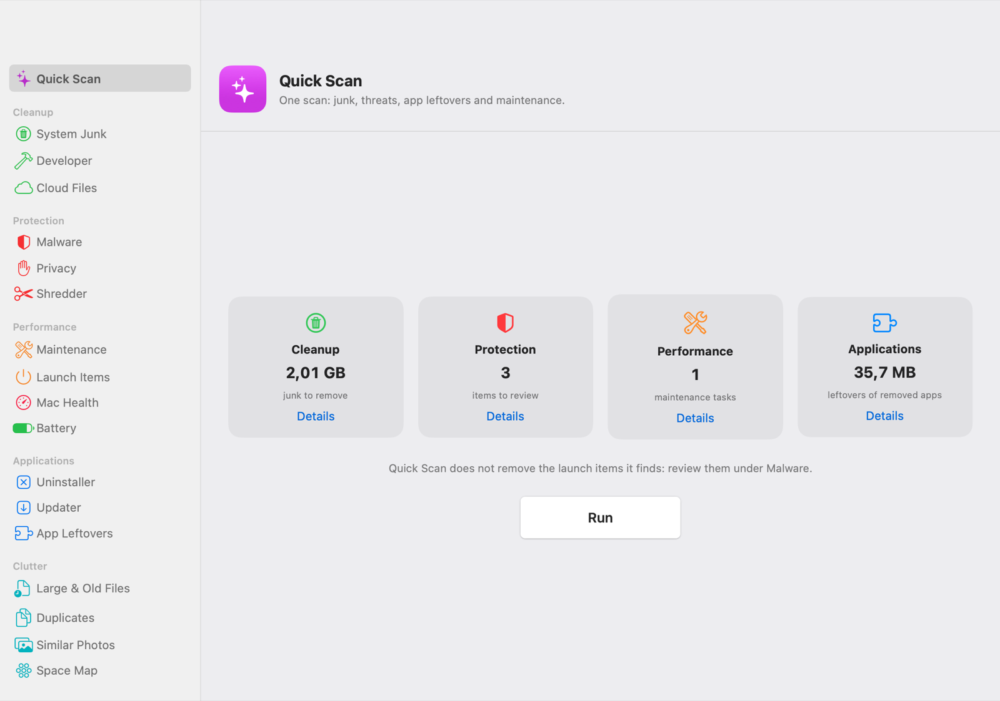
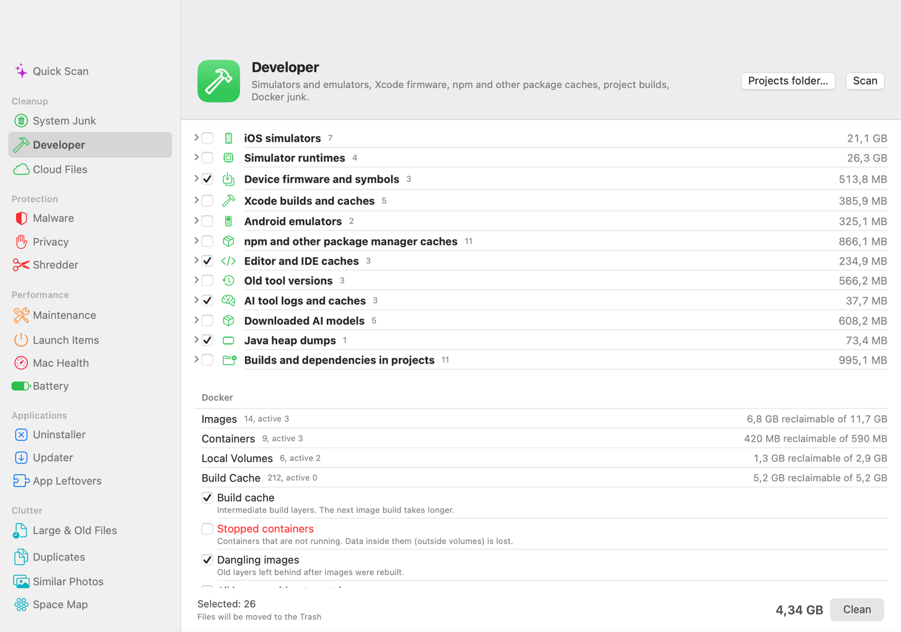
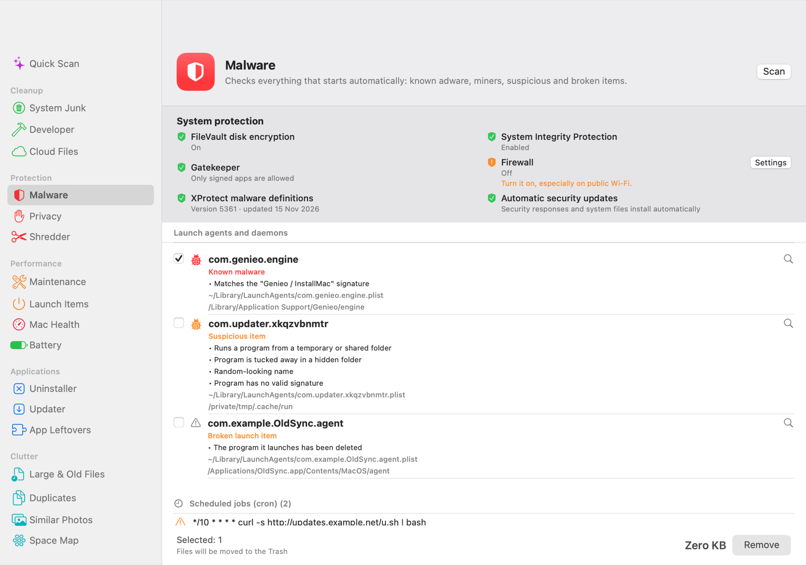
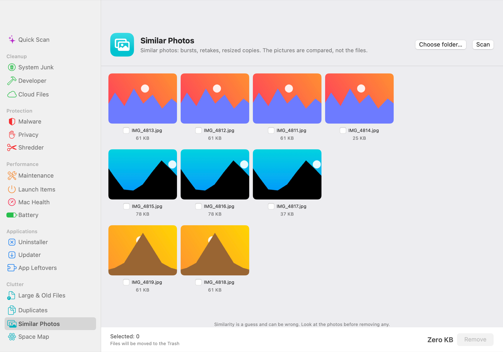
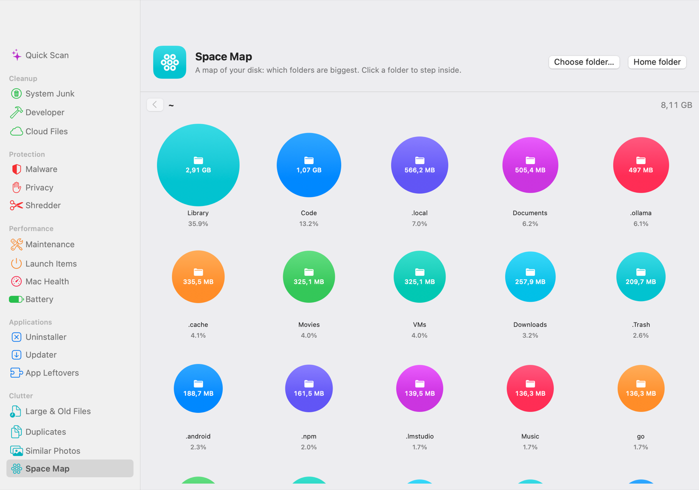
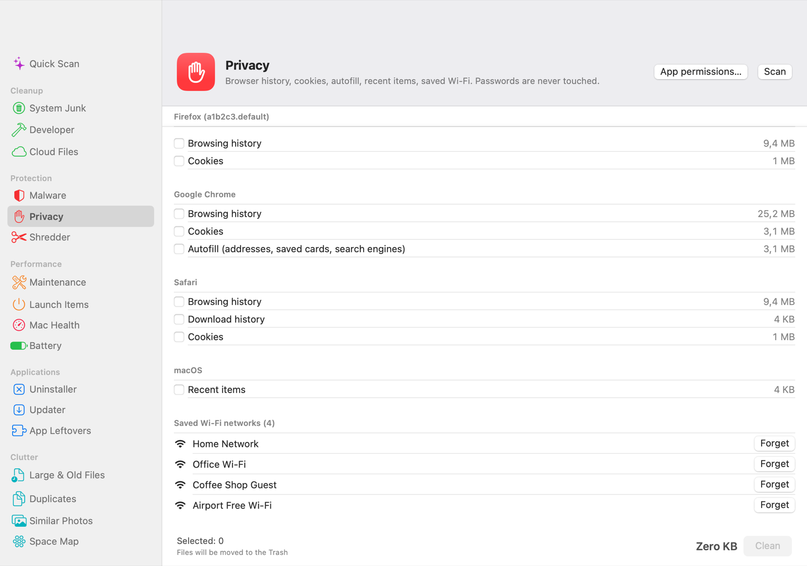
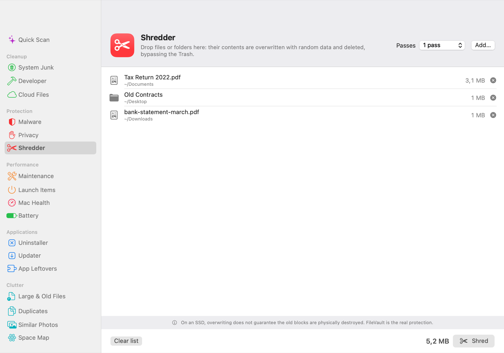
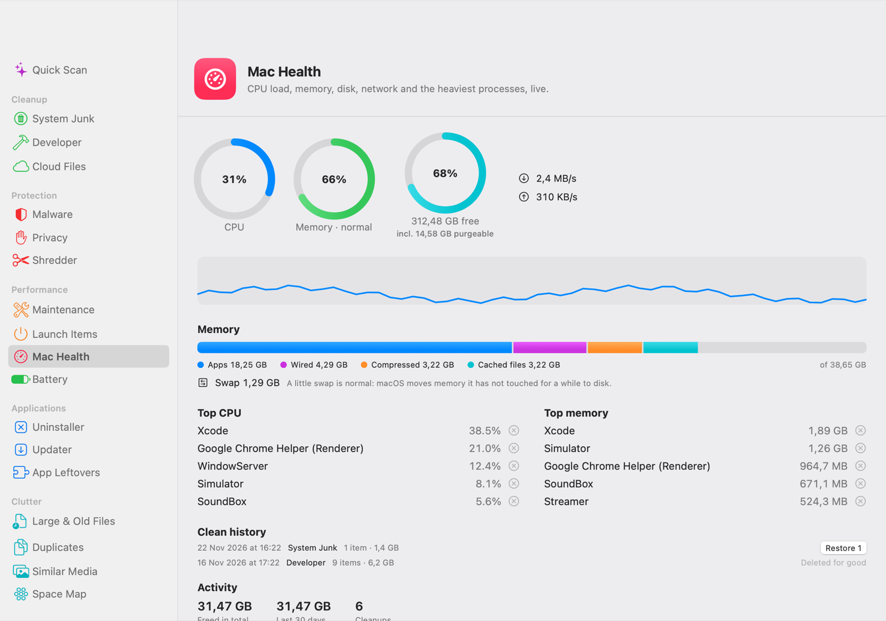
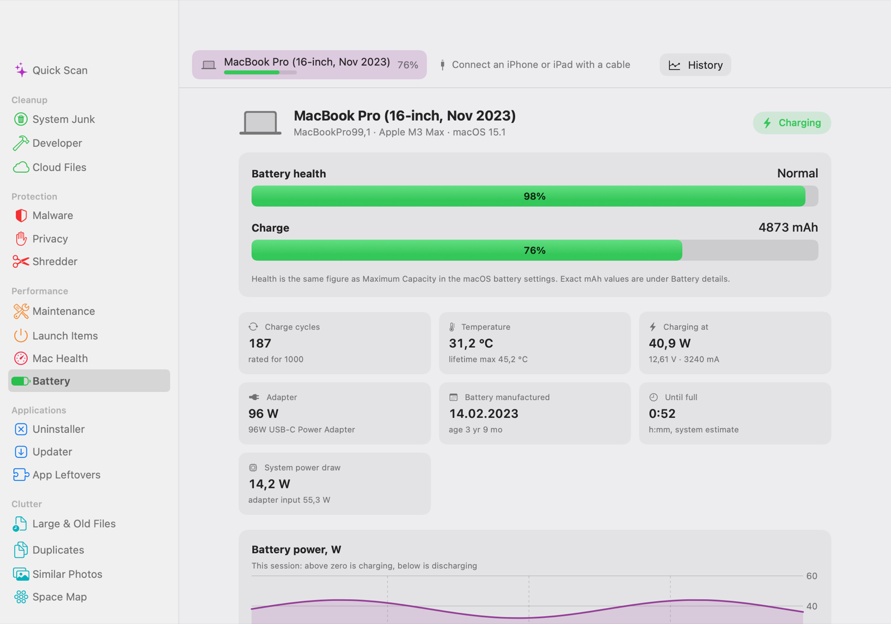
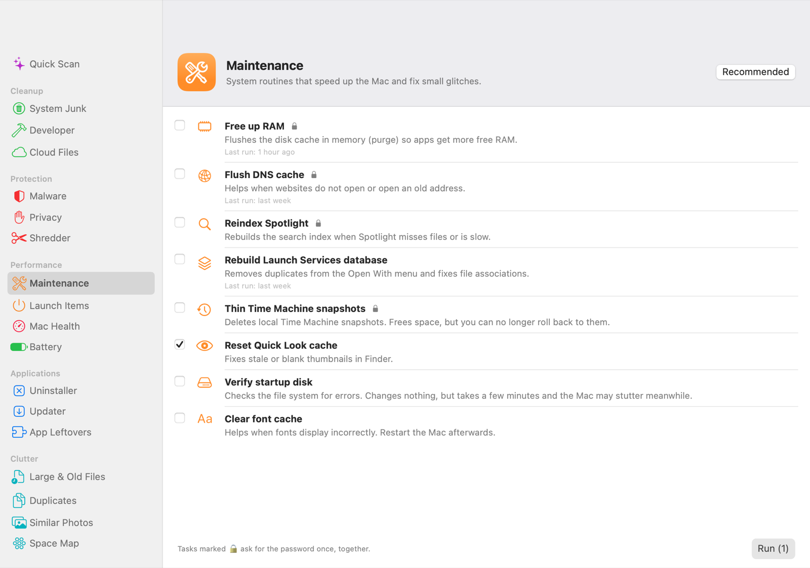

# MyOpenCleaner — free, open-source CleanMyMac alternative for macOS

**MyOpenCleaner is a free, open-source (MIT) Mac cleaner and optimizer written in Swift and SwiftUI.** It removes system junk, developer clutter (Xcode DerivedData, iOS simulators, `node_modules`, Docker, package caches, local AI models), uninstalls apps with all their leftovers, finds duplicates and large files, checks what starts automatically, and shows your Mac's health and battery. Nothing is removed until you choose it, and by default files go to the Trash, so a clean can be undone.

- **Free, no subscription, no account.** MIT-licensed; every feature is in the app, with no paid tier.
- **Private.** No telemetry, no analytics. The only network request is the optional "Check for updates" of your Sparkle-based apps, and only when you press it.
- **Native and small.** One 6 MB SwiftUI app. No Electron, no background daemon, no helper installed as root.
- **Safe by design.** One safety guard checks every deletion; system folders, Keychains, the Photos library and your exclusions can never be removed. By default removals go to the Trash and can be put back with Undo.
- **Built for developers too.** Cleans Xcode, simulators, Android emulators, npm/pnpm/Yarn/pip/uv/Cargo/Go/Gradle/CocoaPods caches, project build folders (git-aware), Docker, and models of Ollama, LM Studio and Hugging Face.
- **Tested.** 250+ automated tests run against fake Macs in temporary folders, so they never touch real files.

**Website:** https://javacava.github.io/myopencleaner/



## Who it is for

- **Anyone whose Mac says the disk is almost full**: one Quick Scan shows what is safe to clean, usually caches, logs, old installers and leftovers of removed apps.
- **Developers**: Xcode, simulators, Docker, package managers and AI models are often 50–150 GB on a developer Mac. MyOpenCleaner lists them per item, with how long ago each project was touched.
- **People who want CleanMyMac features without a subscription**, or who prefer software whose code they can read.
- **Anyone cautious about cleaners**: MyOpenCleaner shows exactly what it will remove, explains why, and lets you undo.

## MyOpenCleaner compared with CleanMyMac

| | MyOpenCleaner | CleanMyMac (MacPaw) |
|---|---|---|
| Price | Free | Paid subscription |
| Source code | Open (MIT) | Closed |
| System junk, uninstaller, leftovers, large & old files, duplicates, similar photos, space map | Yes | Yes |
| Malware and launch-item checks, privacy cleanup, shredder, maintenance tasks, menu bar monitor | Yes | Yes |
| Real-time malware protection, mail unsubscribe, cloud-account cleanup | No | Yes |
| Signed and notarized download | No (build from source, or allow the ad-hoc signed app once) | Yes |

MyOpenCleaner is independent and not affiliated with MacPaw (see [Trademarks](#trademarks)).

Also in MyOpenCleaner: in-depth developer cleanup (Xcode, simulators, Docker, package and IDE caches, git-aware project builds, local AI models), Undo for a whole clean, a warning when files are open in another program, user exclusions, and a command-line clean with dry run and JSON output.

## Requirements

- macOS 14 Sonoma or later (Apple silicon or Intel)
- Xcode 15+ or the Xcode Command Line Tools, to build it

## Install

```bash
git clone https://github.com/javacava/myopencleaner.git
cd myopencleaner
./build.sh --install
```

This builds `dist/MyOpenCleaner.app` and copies it to `/Applications`. Use `./build.sh` alone to build without installing.

### First launch

- **Full Disk Access.** Without it macOS hides Safari history, Mail and some system caches. Open System Settings → Privacy & Security → Full Disk Access and add MyOpenCleaner. The app has a button that opens this page.
- **Sharing a built copy.** The app is signed ad hoc. If you send someone the `.app` instead of the source, they have to right-click it and choose Open the first time, or run `xattr -dr com.apple.quarantine /Applications/MyOpenCleaner.app`.

## Features

### Cleanup

| Page | What it does |
|---|---|
| **Quick Scan** | One scan across junk, threats, app leftovers and maintenance. Asks before cleaning and never needs a password. |
| **System Junk** | User and system caches, logs, browser caches, caches inside sandboxed app containers, Xcode junk, package manager caches, Mail attachments older than 30 days, Trash, iOS backups, incomplete downloads, old installers. |
| **Developer** | iOS simulators and simulator runtimes, IPSW firmware and device symbols, DerivedData, Xcode archives and XCTest devices, the optional Metal toolchain, Android emulators; package caches for npm/npx/Yarn/pnpm/Bun/uv/pip/Poetry/Conda/Deno/CocoaPods/SwiftPM/Gradle/Cargo/Go/NuGet/Ruby gems/Composer/Bazel/Puppeteer; VS Code, Cursor and JetBrains caches; older Claude Code versions (never the one in use); Java heap dumps; logs and caches of local AI tools; downloaded AI models (Ollama, LM Studio, Hugging Face, GPT4All, Jan, Draw Things, Whisper…, one row per model, never preselected; Ollama layers shared by other models are kept); project builds for Node, Swift, Rust, Python, Gradle, CocoaPods, Dart, Unity, Unreal, Godot, .NET, Terraform, Zig, Elixir and Haskell; Docker build cache, images, containers and volumes. |
| **Cloud Files** | Large local copies from iCloud Drive, Dropbox, Google Drive and OneDrive. iCloud files can be kept in the cloud only. |

### Protection

| Page | What it does |
|---|---|
| **Malware** | Also lists the other places code can start from: cron jobs, non-stock periodic scripts, suspicious lines in shell startup files, browser extensions (Chrome, Edge, Brave, Arc, Vivaldi, Firefox), Quick Look and Spotlight plug-ins, login authorization plug-ins, kernel and system extensions, and library injection through launch items. These are shown and revealed in Finder, never removed automatically. Shows the state of the Mac's own protection (FileVault, System Integrity Protection, Gatekeeper, firewall, XProtect definitions, automatic security updates) with a link to fix each one. Checks every launch agent and daemon against known adware and miner families, and flags suspicious ones: programs in `/tmp`, hidden folders, fake Apple names, unsigned binaries with random names. Also finds launch items whose app is gone. |
| **Privacy** | Browsing history, cookies and autofill for Safari, Chrome, Edge, Brave and Firefox (every profile), recent items, saved Wi‑Fi networks. Passwords and bookmarks are never touched. |
| **Shredder** | Drop files or folders on the window or the Dock icon. Contents are overwritten with random data (1, 3 or 7 passes) and deleted without going to the Trash. |

### Performance

| Page | What it does |
|---|---|
| **Maintenance** | Free RAM, flush DNS, reindex Spotlight, rebuild Launch Services, thin Time Machine snapshots, reset Quick Look, verify the startup disk, clear the font cache. Tasks that need a password share one prompt. |
| **Launch Items** | Turn launchd agents and daemons off and on. |
| **Mac Health** | Live CPU, memory pressure, disk (including purgeable space macOS frees on demand), network and the heaviest processes, plus how much space MyOpenCleaner has freed. Also in the menu bar. |
| **Battery** | Health, cycle count, temperature, power draw, adapter, manufacture date and raw registry data for your Mac, and for an iPhone or iPad connected by cable. Keeps a health history you can export as CSV. |

### Applications and clutter

| Page | What it does |
|---|---|
| **Uninstaller** | Removes an app with everything it left in the Library folders, or resets it to a clean state. |
| **Updater** | Checks apps that update through Sparkle and links to the App Store for the rest. |
| **App Leftovers** | Finds settings and caches of apps that are no longer installed. |
| **Large & Old Files** | Filters your home folder by size, age and kind, including virtual machines (Parallels, UTM, VMware, VirtualBox disks), each counted as one item. |
| **Duplicates** | Finds identical files by content (SHA-256). Always keeps at least one copy. |
| **Similar Photos** | Groups bursts, retakes and resized copies with a perceptual hash. |
| **Space Map** | A map of folder sizes you can click through. |

## FAQ

**Is there a free alternative to CleanMyMac?**
Yes. MyOpenCleaner is a free, open-source alternative to CleanMyMac X / CleanMyMac for macOS 14 and later. It covers system junk, app uninstalling with leftovers, large and duplicate files, similar photos, a disk space map, malware and launch-item checks, privacy cleanup, maintenance tasks and a menu bar monitor, plus developer cleanup that CleanMyMac does not go into.

**Is MyOpenCleaner safe to use?**
It is built to be hard to misuse: scanning never changes anything, risky items start unselected, every path passes a safety guard (system folders, Keychains, `~/Documents` itself, the Photos library and your exclusions are refused), removed items go to the Trash and can be restored with Undo, and it warns when a program still has the files open. As with any cleaner, look at what is selected before you press Clean.

**Does MyOpenCleaner collect data or need an internet connection?**
No. There is no telemetry and no account. The only network request is the optional update check for installed apps that use Sparkle, and only when you press "Check".

**How do I free up "System Data" or disk space on a Mac?**
Run Quick Scan or System Junk for caches, logs and installers; Developer for Xcode, simulators and package caches; Large & Old Files and Space Map to see what is big; Mac Health shows purgeable space that macOS frees by itself, and Maintenance can thin local Time Machine snapshots.

**How do I delete Xcode DerivedData, old iOS simulators and simulator runtimes?**
Open Developer. DerivedData, device symbols and caches are listed with sizes; simulators and runtimes are removed through Apple's own `simctl`, and simulators whose runtime is gone are preselected.

**How do I find and delete `node_modules`, `target`, `.build` and other build folders?**
Developer → Builds and dependencies lists them for Node, Swift, Rust, Python, Gradle, CocoaPods, Dart, Unity, Unreal, Godot, .NET, Terraform, Zig, Elixir and Haskell projects, with days since the project changed. A folder counts only next to its project file, and inside a git repository only if nothing in it is tracked.

**How do I remove downloaded Ollama, LM Studio or Hugging Face models?**
Developer → Downloaded AI models lists each model with its size. Nothing is preselected; for Ollama, layers shared with other models are kept.

**How do I completely uninstall a Mac app?**
Uninstaller lists the app and every file it keeps in the Library folders (preferences, caches, containers, launch agents…). Remove takes everything selected; Reset keeps the app and clears its data. App Leftovers finds files of apps you already deleted.

**Can I use it from the terminal or in scripts?**
Yes: `MyOpenCleaner --clean` prints a dry run, `--yes` moves the items to the Trash, `--category` and `--json` are available. See [Command line](#command-line).

**Which Macs does it run on?**
macOS 14 Sonoma or later. Build it from source on Apple silicon or Intel.

## Screenshots

| | |
|---|---|
|  **System Junk** |  **Developer** |
|  **Uninstaller** |  **Malware** |
|  **Duplicates** |  **Similar Photos** |
|  **Space Map** |  **Large & Old Files** |
|  **Privacy** |  **Shredder** |
|  **Mac Health** |  **Battery** |
|  **Maintenance** |  **Launch Items** |
|  **Cloud Files** |  **Menu bar** |

The screenshots show a made-up demo Mac: every app, file, project, simulator and Wi‑Fi name in them is invented.

## Safety

MyOpenCleaner is built to make the worst case boring.

- **One gate for every deletion.** `SafetyGuard` refuses anything outside your home folder, `/Library`, `/Applications` and a few log and temp folders. `/System`, `/usr`, Keychains and the Photos and Music libraries can never be removed. Folders such as `~/Documents`, `~/Library`, `~/.ssh`, iCloud Drive, Safari and Messages can be emptied by a module but never deleted themselves. Paths are compared without case, and `..` or symlinks pointing elsewhere are rejected.
- **Trash first.** Everything goes to the Trash unless you switch to permanent deletion in Settings. Only privacy traces, the Shredder, simulators and Docker delete permanently, and each of them says so before it starts.
- **Nothing preselected that you might miss.** Scanning changes nothing. Risky items (iOS backups, Xcode archives, installers, leftovers, simulators, project builds, duplicates, similar photos) start unselected.
- **No silent removals.** Quick Scan asks before cleaning and only reports launch items; removing one is always your decision.
- **Undo.** Every clean is recorded. Right after it, a toast offers Undo, and Mac Health → Clean history can put any clean whose items are still in the Trash back where they were. Nothing is ever overwritten on the way back.
- **Nothing in use.** Before removing, MyOpenCleaner asks `lsof` which programs have the files open and names them in the confirmation, so you can quit them first.
- **Git knows best.** In a git repository a build folder is offered only if nothing in it is tracked, it is not a nested repository, and generic names (`build`, `bin`, `target`, `venv`…) are git-ignored. Without a usable git, only tool-specific folders such as `node_modules` are offered there.
- **Your exclusions win.** Add any file or folder in Settings → Exclusions, or right-click it in a list and choose "Never offer this again". Excluded paths, and everything inside them, are hidden from every page and refused by `SafetyGuard`.
- **No shell.** External tools run with fixed arguments, and simulator IDs are validated as UUIDs before they reach a command line.
- **Read-only checks stay read-only.** The protection status only asks macOS for its state; it never changes a setting.

What it cannot do: on an SSD, the Shredder cannot guarantee the old blocks are physically destroyed (FileVault is the real protection there), and the Uninstaller really does delete an app's data when you ask it to.

## Command line

```bash
swift build
.build/debug/MyOpenCleaner --clean                        # dry run: what would be cleaned, nothing is removed
.build/debug/MyOpenCleaner --clean --yes                  # move the default selection to the Trash
.build/debug/MyOpenCleaner --clean --category trash,userLogs --json   # pick categories, print JSON
.build/debug/MyOpenCleaner --clean --help                 # all options
```

`--clean` never deletes outright: with `--yes` it moves items to the Trash (only what is already in the Trash is emptied for good), it respects your exclusions, and it exits with code 1 if anything could not be removed. The installed app works the same way: `/Applications/MyOpenCleaner.app/Contents/MacOS/MyOpenCleaner --clean`.

Read-only modes print what a page would offer, without deleting anything:

```bash
.build/debug/MyOpenCleaner --scan               # system junk and launch-item threats
.build/debug/MyOpenCleaner --dev-scan           # the Developer page
.build/debug/MyOpenCleaner --snapshot <folder>  # render every page to PNG (shows your real data)
.build/debug/MyOpenCleaner --snapshot <folder> --demo  # the same for a made-up Mac; safe to publish
```

`--demo` builds a fake home folder full of invented apps, junk, projects and photos in a temporary directory, answers every external tool (`simctl`, `docker`, `ps`, `networksetup`…) with canned output instead of running it, and deletes the fake Mac when it is done. File icons are replaced with neutral symbols so the screenshots do not reveal which apps are installed on the machine that renders them. The images in `docs/screenshots` were made this way.

## Development

```bash
swift build   # debug build
swift test    # run all tests
```

```
Sources/SweepCore/    scanning and cleaning engine, no UI
Sources/MyOpenCleaner/     SwiftUI app, menu bar, settings; Battery/ for the battery page
Tests/SweepCoreTests/ engine tests against fake Macs in temporary folders
Tests/MyOpenCleanerTests/  battery data parsing tests
scripts/              app icon generator used by build.sh
docs/screenshots/     README images, rendered with --snapshot --demo
```

Every scanner takes a `SweepEnvironment` with its own home and root folder. Tests build a throwaway Mac in a temporary directory, so they run anywhere and never read or delete your real files. New features should come with tests in the same style; `RiskRegressionTests.swift` collects one test per safety issue found during review.

### Where the app keeps its data

Nothing is written into the repository at run time. The activity log and battery history live in `~/Library/Application Support/MyOpenCleaner/`, and settings in `~/Library/Preferences/local.myopencleaner.app.plist`.

## Credits

These projects were studied for ideas. No code was copied from them; everything here was written from scratch.

| Project | License | What it informed |
|---|---|---|
| [tw93/Mole](https://github.com/tw93/Mole) | GPL-3.0 | Which junk categories are worth cleaning |
| [alienator88/Pearcleaner](https://github.com/alienator88/Pearcleaner) | Apache 2.0 + Commons Clause | How to match an app's leftovers by bundle ID, name and container metadata |
| [exelban/stats](https://github.com/exelban/stats) | MIT | Reading CPU and memory statistics |
| [iliyami/MacSai](https://github.com/iliyami/MacSai) | BSD-3-Clause | A clean history with restore |
| [guhcostan/mac-cleaner-cli](https://github.com/guhcostan/mac-cleaner-cli) | MIT | Checking git before removing build folders |
| [jithin-sabu/purge-app](https://github.com/jithin-sabu/purge-app) | MIT | Local AI model stores, the Metal toolchain, VM bundles |
| [tbillington/kondo](https://github.com/tbillington/kondo), [bysiber/cleardisk](https://github.com/bysiber/cleardisk) | MIT | More project types and developer cache locations |
| [objective-see/KnockKnock](https://github.com/objective-see/KnockKnock) | GPL-3.0 | The list of places to look for persistence (no code used) |
| [sveinbjornt/Sloth](https://github.com/sveinbjornt/Sloth) | BSD-3-Clause | Asking `lsof` which programs hold files open |
| [2ykwang/mac-cleanup-go](https://github.com/2ykwang/mac-cleanup-go), [mac-cleanup/mac-cleanup-py](https://github.com/mac-cleanup/mac-cleanup-py) | MIT, Apache-2.0 | Old Claude Code versions, Java heap dumps |
| [momenbasel/PureMac](https://github.com/momenbasel/PureMac) | MIT | Extra developer and AI-tool cache locations, sandbox container caches, the protection status, exclusions, a real Full Disk Access check, a command-line clean |

## Trademarks

CleanMyMac is a trademark of MacPaw. MyOpenCleaner is an independent open-source project and is not affiliated with, endorsed by or sponsored by MacPaw. Mac and macOS are trademarks of Apple Inc. Other product names are used only to describe compatibility or to compare features, and belong to their owners.

## License

MyOpenCleaner is released under the [MIT License](LICENSE). You can use, change and share it, including in commercial projects, as long as the license notice stays with the code.

MyOpenCleaner deletes files you choose. It comes with no warranty: keep backups, and look at what is selected before you clean.
