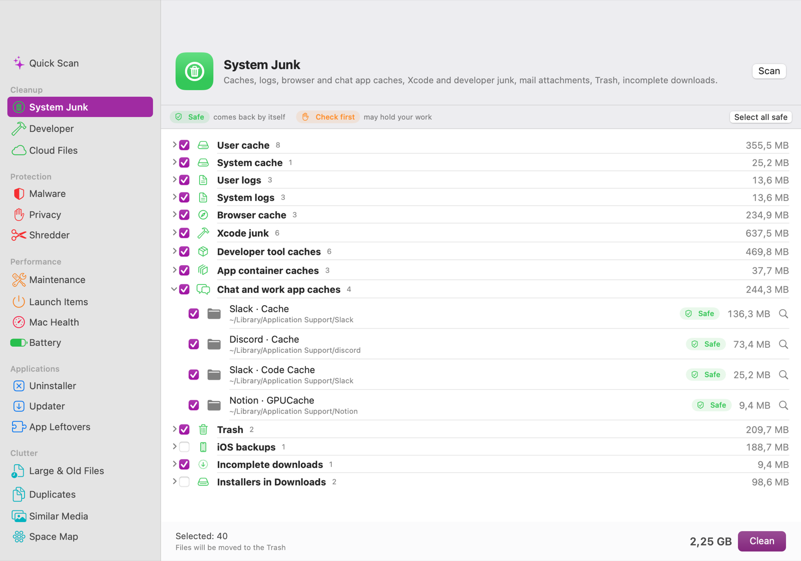
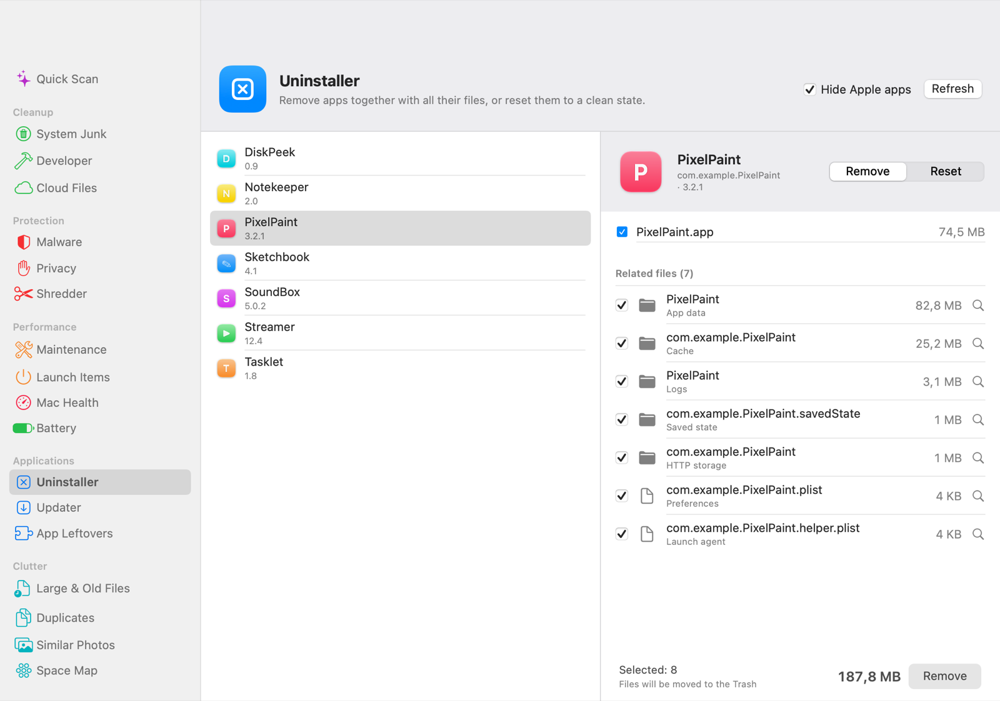
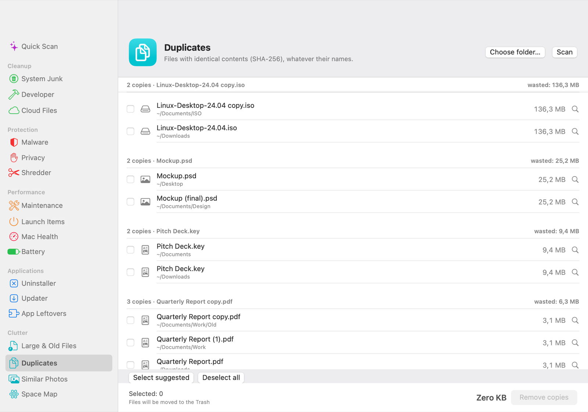
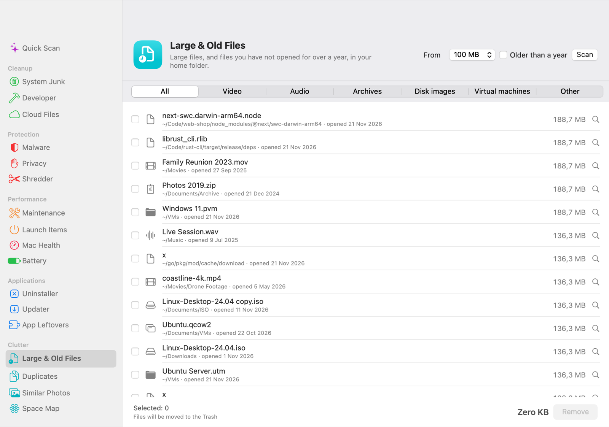
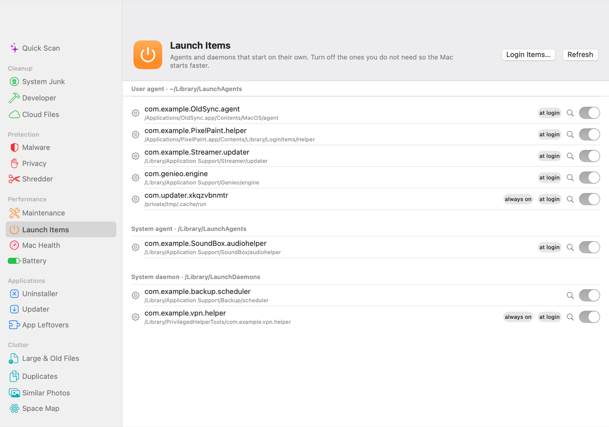
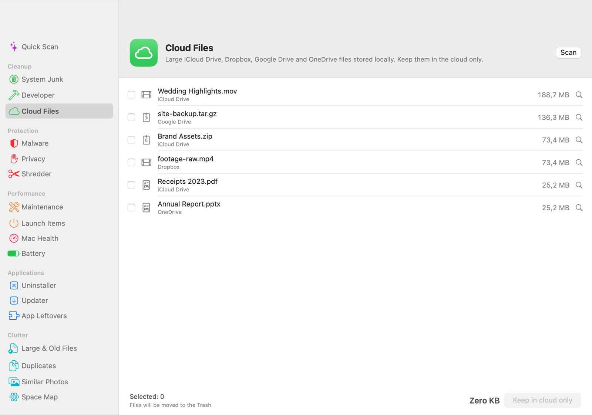
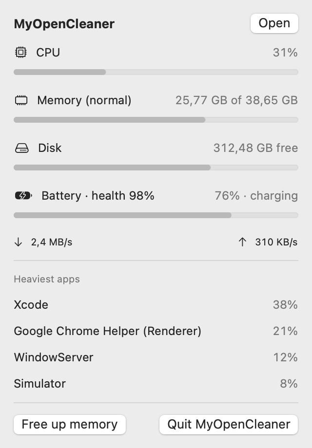

# MyOpenCleaner

A free, open-source Mac cleaner in the spirit of CleanMyMac, written in Swift and SwiftUI.

MyOpenCleaner finds system junk, developer clutter, leftovers of removed apps, duplicates and large files, checks what starts automatically, and shows your Mac's health and battery. It never deletes anything you did not choose, and by default everything goes to the Trash.

- **Native and small**: one SwiftUI app, no Electron, no background daemon, no network calls except optional update checks.
- **Safe by design**: every deletion passes one safety guard that protects system folders and your personal data.
- **Tested**: 180+ tests run against fake Macs in temporary folders, so they never touch your files.


## Requirements

- macOS 14 Sonoma or later (Apple silicon or Intel)
- Xcode 15+ or the Xcode Command Line Tools, to build it

## Install

```bash
git clone https://github.com/javacava/myopencleaner.git
cd myopencleaner
./build.sh --install
```

This builds `dist/MyOpenCleaner.app` and copies it to `/Applications`. Use `./build.sh` alone to build without installing.

### First launch

- **Full Disk Access.** Without it macOS hides Safari history, Mail and some system caches. Open System Settings → Privacy & Security → Full Disk Access and add MyOpenCleaner. The app has a button that opens this page.
- **Sharing a built copy.** The app is signed ad hoc. If you send someone the `.app` instead of the source, they have to right-click it and choose Open the first time, or run `xattr -dr com.apple.quarantine /Applications/MyOpenCleaner.app`.

## Features

### Cleanup

| Page | What it does |
|---|---|
| **Quick Scan** | One scan across junk, threats, app leftovers and maintenance. Asks before cleaning and never needs a password. |
| **System Junk** | User and system caches, logs, browser caches, Xcode junk, package manager caches, Mail attachments older than 30 days, Trash, iOS backups, incomplete downloads, old installers. |
| **Developer** | iOS simulators and simulator runtimes, IPSW firmware and device symbols, DerivedData and Xcode archives, Android emulators, npm/npx/Yarn/pnpm/Bun/pip/CocoaPods/SwiftPM/Gradle/Cargo/Go caches, project builds (`node_modules`, `.build`, `target`, `Pods`, `build`), and Docker build cache, images, containers and volumes. |
| **Cloud Files** | Large local copies from iCloud Drive, Dropbox, Google Drive and OneDrive. iCloud files can be kept in the cloud only. |

### Protection

| Page | What it does |
|---|---|
| **Malware** | Checks every launch agent and daemon against known adware and miner families, and flags suspicious ones: programs in `/tmp`, hidden folders, fake Apple names, unsigned binaries with random names. Also finds launch items whose app is gone. |
| **Privacy** | Browsing history, cookies and autofill for Safari, Chrome, Edge, Brave and Firefox (every profile), recent items, saved Wi‑Fi networks. Passwords and bookmarks are never touched. |
| **Shredder** | Drop files or folders on the window or the Dock icon. Contents are overwritten with random data (1, 3 or 7 passes) and deleted without going to the Trash. |

### Performance

| Page | What it does |
|---|---|
| **Maintenance** | Free RAM, flush DNS, reindex Spotlight, rebuild Launch Services, thin Time Machine snapshots, reset Quick Look, verify the startup disk, clear the font cache. Tasks that need a password share one prompt. |
| **Launch Items** | Turn launchd agents and daemons off and on. |
| **Mac Health** | Live CPU, memory pressure, disk, network and the heaviest processes, plus how much space MyOpenCleaner has freed. Also in the menu bar. |
| **Battery** | Health, cycle count, temperature, power draw, adapter, manufacture date and raw registry data for your Mac, and for an iPhone or iPad connected by cable. Keeps a health history you can export as CSV. |

### Applications and clutter

| Page | What it does |
|---|---|
| **Uninstaller** | Removes an app with everything it left in the Library folders, or resets it to a clean state. |
| **Updater** | Checks apps that update through Sparkle and links to the App Store for the rest. |
| **App Leftovers** | Finds settings and caches of apps that are no longer installed. |
| **Large & Old Files** | Filters your home folder by size, age and kind. |
| **Duplicates** | Finds identical files by content (SHA-256). Always keeps at least one copy. |
| **Similar Photos** | Groups bursts, retakes and resized copies with a perceptual hash. |
| **Space Map** | A map of folder sizes you can click through. |

## Screenshots

| | |
|---|---|
|  **System Junk** |  **Developer** |
|  **Uninstaller** |  **Malware** |
|  **Duplicates** |  **Similar Photos** |
|  **Space Map** |  **Large & Old Files** |
|  **Privacy** |  **Shredder** |
|  **Mac Health** |  **Battery** |
|  **Maintenance** |  **Launch Items** |
|  **Cloud Files** |  **Menu bar** |

The screenshots show a made-up demo Mac: every app, file, project, simulator and Wi‑Fi name in them is invented.

## Safety

MyOpenCleaner is built to make the worst case boring.

- **One gate for every deletion.** `SafetyGuard` refuses anything outside your home folder, `/Library`, `/Applications` and a few log and temp folders. `/System`, `/usr`, Keychains and the Photos and Music libraries can never be removed. Folders such as `~/Documents`, `~/Library`, `~/.ssh`, iCloud Drive, Safari and Messages can be emptied by a module but never deleted themselves. Paths are compared without case, and `..` or symlinks pointing elsewhere are rejected.
- **Trash first.** Everything goes to the Trash unless you switch to permanent deletion in Settings. Only privacy traces, the Shredder, simulators and Docker delete permanently, and each of them says so before it starts.
- **Nothing preselected that you might miss.** Scanning changes nothing. Risky items (iOS backups, Xcode archives, installers, leftovers, simulators, project builds, duplicates, similar photos) start unselected.
- **No silent removals.** Quick Scan asks before cleaning and only reports launch items; removing one is always your decision.
- **No shell.** External tools run with fixed arguments, and simulator IDs are validated as UUIDs before they reach a command line.

What it cannot do: on an SSD, the Shredder cannot guarantee the old blocks are physically destroyed (FileVault is the real protection there), and the Uninstaller really does delete an app's data when you ask it to.

## Command line

The app binary has read-only modes that print what it would offer, without deleting anything:

```bash
swift build
.build/debug/MyOpenCleaner --scan               # system junk and launch-item threats
.build/debug/MyOpenCleaner --dev-scan           # the Developer page
.build/debug/MyOpenCleaner --snapshot <folder>  # render every page to PNG (shows your real data)
.build/debug/MyOpenCleaner --snapshot <folder> --demo  # the same for a made-up Mac; safe to publish
```

`--demo` builds a fake home folder full of invented apps, junk, projects and photos in a temporary directory, answers every external tool (`simctl`, `docker`, `ps`, `networksetup`…) with canned output instead of running it, and deletes the fake Mac when it is done. File icons are replaced with neutral symbols so the screenshots do not reveal which apps are installed on the machine that renders them. The images in `docs/screenshots` were made this way.

## Development

```bash
swift build   # debug build
swift test    # run all tests
```

```
Sources/SweepCore/    scanning and cleaning engine, no UI
Sources/MyOpenCleaner/     SwiftUI app, menu bar, settings; Battery/ for the battery page
Tests/SweepCoreTests/ engine tests against fake Macs in temporary folders
Tests/MyOpenCleanerTests/  battery data parsing tests
scripts/              app icon generator used by build.sh
docs/screenshots/     README images, rendered with --snapshot --demo
```

Every scanner takes a `SweepEnvironment` with its own home and root folder. Tests build a throwaway Mac in a temporary directory, so they run anywhere and never read or delete your real files. New features should come with tests in the same style; `RiskRegressionTests.swift` collects one test per safety issue found during review.

### Where the app keeps its data

Nothing is written into the repository at run time. The activity log and battery history live in `~/Library/Application Support/MyOpenCleaner/`, and settings in `~/Library/Preferences/local.myopencleaner.app.plist`.

## Credits

These projects were studied for ideas. No code was copied from them.

| Project | License | What it informed |
|---|---|---|
| [tw93/Mole](https://github.com/tw93/Mole) | GPL-3.0 | Which junk categories are worth cleaning |
| [alienator88/Pearcleaner](https://github.com/alienator88/Pearcleaner) | Apache 2.0 + Commons Clause | How to match an app's leftovers by bundle ID, name and container metadata |
| [exelban/stats](https://github.com/exelban/stats) | MIT | Reading CPU and memory statistics |

## License

MyOpenCleaner is released under the [MIT License](LICENSE). You can use, change and share it, including in commercial projects, as long as the license notice stays with the code.

MyOpenCleaner deletes files you choose. It comes with no warranty: keep backups, and look at what is selected before you clean.
